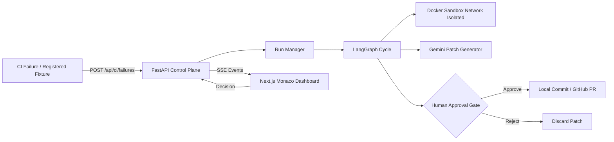

# AutoPatch

> Autonomous, sandboxed test remediation control plane for CI pipelines.

AutoPatch is an autonomous code remediation service for failing automated tests. It ingests a failing implementation and its associated test suite, proposes a patch with a language model, validates the change inside an isolated Docker sandbox, and requires explicit human approval before committing or opening a pull request.

The system is designed for CI/CD integration: when a pipeline reports a test failure, AutoPatch takes over the remediation loop instead of leaving the failure idle until a developer context-switches to triage it.

---

## Capabilities

- **Stateful remediation workflow:** Ingest → Execute Tests → Patch → Re-test → Evaluate
- **Network-isolated Docker execution:** Zero internet egress (`network_disabled = True`) for untrusted generated code
- **Multi-runtime support:** Python (`pytest`) and Node.js (`Jest`)
- **Real-time telemetry:** Live run streaming over Server-Sent Events (SSE)
- **Monaco diff review:** Side-by-side patch inspection in the dashboard
- **Human-in-the-Loop (HITL):** Explicit human gate before local commits or GitHub PR generation
- **CI failure webhook:** Direct ingestion endpoint for CI/CD runners

---

## Architecture



| Component | Technology | Rationale |
| --- | --- | --- |
| **Model** | Google Gemini Flash / Flash-Lite | Fast API tier with structured patch generation |
| **Orchestration** | LangGraph with Checkpointed Interrupts | Pause/resume execution without blocking threads |
| **Sandbox** | Docker Engine API (`network_disabled: true`) | Strict isolation; prevents credential exfiltration or rogue loops |
| **API Layer** | FastAPI, SSE (Server-Sent Events) | Lightweight, unidirectional streaming without WebSocket overhead |
| **Dashboard** | Next.js, Monaco Diff Viewer | Full-fidelity side-by-side git diff review and state-machine visualization |
| **VCS Integration** | Git CLI + GitHub Pulls REST API | Automated branch generation and human-authorized PR authoring |

---

## Repository Layout

```text
Autopatch/
├── backend/            # FastAPI control plane, LangGraph state machine, Docker isolation
├── frontend/           # Next.js operations dashboard, Monaco diff viewer, SSE client
├── docs/               # Technical case study and architecture documentation
├── fixtures/           # Python test failure fixtures
├── samples/            # Node / Next.js cart sample project (intentionally failing for demo)
├── demo/               # Operational walkthrough and demo guide
├── scripts/            # Local CI simulation and development automation
└── .github/workflows/  # CI bridge workflow (workflow_dispatch)
```

---

## Prerequisites

- **Python 3.11+**
- **Node.js 20+**
- **Docker Engine / Docker Desktop**
- **Google AI Studio API Key** (`GEMINI_API_KEY`)

---

## Setup & Running

### 1. Backend

```bash
cd backend
python -m venv .venv

# Windows
.\.venv\Scripts\activate
# macOS / Linux
# source .venv/bin/activate

pip install -r requirements.txt
cp .env.example .env
```

Configure your `.env`:

```env
GEMINI_API_KEY=your_api_key_here
GEMINI_MODEL=gemini-flash-lite-latest
DOCKER_IMAGE=autopatch-sandbox:latest
DOCKER_NODE_IMAGE=autopatch-node-sandbox:latest
```

Build the sandbox images:

```bash
docker build -t autopatch-sandbox:latest .\sandbox
docker build -t autopatch-node-sandbox:latest .\sandbox-node
```

Start the API:

```bash
uvicorn app.main:app --host 127.0.0.1 --port 8000
```

### 2. Frontend

```bash
cd frontend
npm install
npx next dev -p 3000
```

- **Dashboard:** [http://localhost:3000](http://localhost:3000)
- **API Health:** [http://127.0.0.1:8000/api/health](http://127.0.0.1:8000/api/health)

---

## Usage

### Dashboard

1. Select a registered fixture (for example **Next.js Cart Pricing**)
2. Start remediation
3. Monitor graph state, sandbox logs, and the generated diff
4. Approve to commit (and open a PR when GitHub env vars are configured), or reject to discard

### CI bridge

```http
POST /api/ci/failures
Content-Type: application/json

{
  "fixture_id": "nextjs_pricing",
  "error_log": "<failing job output>",
  "repo": "owner/repo",
  "branch": "main",
  "commit_sha": "abc123"
}
```

Local simulation:

```powershell
.\scripts\simulate-ci.ps1
```

Reference workflow: [`.github/workflows/autopatch-ci.yml`](.github/workflows/autopatch-ci.yml)  
(Manual `workflow_dispatch` only — keeps `main` green; the cart sample stays intentionally failing for local demos.)

---

## API Reference

| Method | Path | Description |
| --- | --- | --- |
| `GET` | `/api/health` | Service health and key configuration status |
| `GET` | `/api/fixtures` | Registered remediation targets |
| `POST` | `/api/runs` | Start a run from a fixture id |
| `POST` | `/api/ci/failures` | Start a run from CI failure payload |
| `GET` | `/api/runs/{id}` | Run snapshot |
| `GET` | `/api/runs/{id}/events` | SSE event stream |
| `POST` | `/api/runs/{id}/decision` | `{ "decision": "approve" \| "reject" }` |

---

## Registered Fixtures

| ID | Runtime | Description |
| --- | --- | --- |
| `nextjs_pricing` | Node / Jest | Percent discount applied without scaling by 100 |
| `off_by_one` | Python / pytest | Inclusive sum off-by-one in `range` |
| `wrong_return` | Python / pytest | Palindrome check compares cleaned vs raw input |
| `missing_import` | Python / pytest | Uses `mean` without importing it |
| `type_coercion` | Python / pytest | Returns strings where ints are expected |
| `fizzbuzz_bug` | Python / pytest | `% 15` checked after `% 3` / `% 5` |

---

## Safety & Governance Controls

1. **Deterministic Exit Codes (`Evaluate ≠ LLM`):** Routing relies strictly on process exit codes (0 vs non-zero) and bounded retry budgets, preventing hallucinated passes.
2. **Untrusted Code Isolation:** Containers run with `network_disabled = True`, hard CPU caps, memory limits, and execution timeouts.
3. **No Host Bind Mounts:** Ephemeral workspaces use `put_archive` tar streams into containers to eliminate host pollution.
4. **Mandatory Approval Gate:** Code cannot be merged or committed without explicit operator approval in the dashboard.

---

## Technical Case Study

For in-depth systems design, threat model, and architectural trade-offs, read the [Technical Case Study](docs/CASE_STUDY.md).

---

## License

MIT
