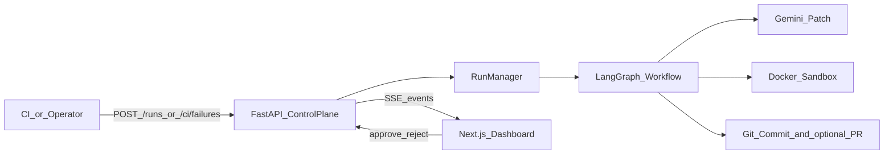
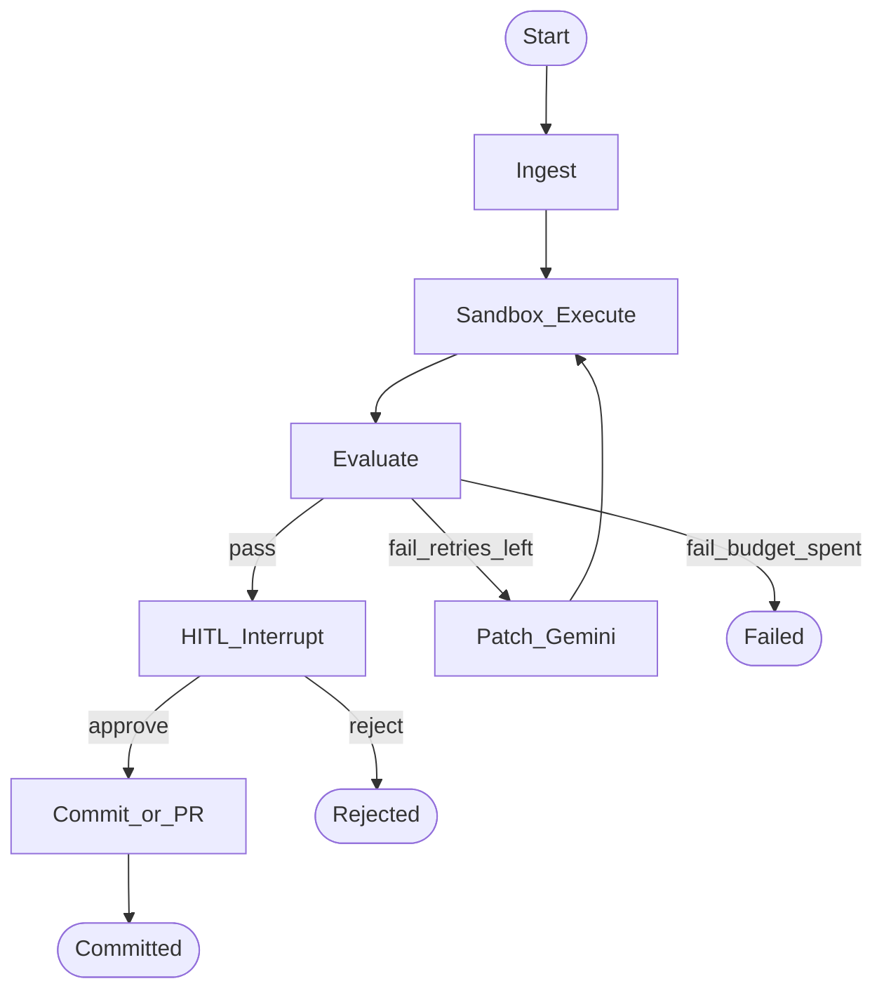

# AutoPatch — Technical Case Study

**Autonomous, sandboxed remediation for failing CI tests**  
**Role:** Sole engineer (architecture, backend, isolation layer, operator UI, CI contract)  
**Stack:** LangGraph · FastAPI · Docker · Gemini · Next.js · SSE · GitHub API

---

## 1. Problem

When CI unit tests fail, pipelines stay red while engineers context-switch to triage often-trivial defects (off-by-ones, missing imports, bad pure-function math). Chat-style AI assistants are a poor fit: they lack closed-loop re-execution, isolation for untrusted output, and an approval boundary before repository mutation.

**Objective:** Reduce time-to-green for *scoped* test failures by proposing and validating patches in isolation, while keeping humans in control of persistence.

---

## 2. Solution

**AutoPatch** is a remediation control system—not a chatbot.

1. **Ingest** scoped source + tests + traceback (not the monorepo)  
2. **Sandbox** the same test command in Docker (`network_disabled`, CPU/memory/timeout limits)  
3. **Loop** via LangGraph: evaluate exit code → patch with Gemini → re-test until green or budget exhausted  
4. **HITL interrupt** — graph pauses; no auto-merge  
5. **Persist** — operator reviews Monaco diff + live logs; Approve → local commit or optional GitHub PR  

**Philosophy:** *Generated code is untrusted. The sandbox and the human gate are the product.*

---

## 3. Architecture

### 3.1 System context

### 3.2 Remediation state machine

### 3.3 Component map

| Plane | Responsibility | Key modules |
|-------|----------------|-------------|
| Control | Run lifecycle, CI ingest, SSE, decisions | `api/runs.py`, `run_manager.py` |
| Orchestration | Cyclic graph + checkpointed HITL interrupt | `graph/workflow.py`, `nodes.py`, `state.py` |
| Execution | Ephemeral containers, log stream | `tools/docker_sandbox.py` |
| Model | Scoped patch generation | `services/gemini.py` |
| Persistence | Local git; optional Pulls API | `git_commit.py`, `github_pr.py` |
| Presentation | Graph, diff, terminal, Approve/Reject | `frontend/src/app/page.tsx` + components |

---

## 4. Key engineering decisions

| Decision | Rationale |
|----------|-----------|
| **Tests before first LLM call** | First sandbox run yields a real traceback; reduces speculative patches |
| **Evaluate ≠ LLM** | Routing is exit-code + retry budget; model only drafts source |
| **LangGraph `interrupt`** | Proper pause/resume with checkpointer vs ad-hoc polling flags |
| **`network_disabled` + baked images** | Untrusted code cannot exfiltrate; deps available offline |
| **`put_archive` overlay** | Ephemeral workspace without broad host bind mounts |
| **Scoped prompts** | Blast radius limited to registered `source_file` |
| **SSE telemetry** | One-way live logs/status fit ops console without WebSocket complexity |
| **HITL before persist** | Green sandbox ≠ merge rights |

### Threat model (summary)

| Risk | Control |
|------|---------|
| Malicious/network-calling model output | No container network; fixed test commands |
| Hang / resource abuse | Timeout + kill; mem/CPU caps |
| Host compromise via exec | No host-side execution of generated code |
| Silent bad merge | Mandatory Approve/Reject gate |

---

## 5. API & CI contract

| Method | Path | Purpose |
|--------|------|---------|
| `POST` | `/api/runs` | Operator starts fixture remediation |
| `POST` | `/api/ci/failures` | CI posts `error_log` + optional repo/SHA |
| `GET` | `/api/runs/{id}/events` | SSE stream (`log`, `patch`, `hitl`, …) |
| `POST` | `/api/runs/{id}/decision` | `{ "decision": "approve" \| "reject" }` |

**Adoption:** register failing module as fixture → webhook on red CI → review in dashboard → Approve → PR/merge.

Reference workflow: manual `workflow_dispatch` (keeps default branch green; sample cart remains intentionally failing for demos). Local mirror: `scripts/simulate-ci.ps1`.

---

## 6. Validation

| Target | Runtime | Result pattern |
|--------|---------|----------------|
| `nextjs_pricing` | Jest | Red → patch `lib/pricing.ts` → green → HITL → commit |
| `off_by_one` / other fixtures | pytest | Same control path, Python sandbox |

**Success criteria:** initial fail (when defective) → scoped diff → sandbox pass within iteration budget → blocked HITL → commit only after approve.

*Attach in PDF: architecture figures above, dashboard HITL screenshot, Monaco diff, green sandbox terminal.*

---

## 7. Limitations & next steps

**Now:** in-memory runs, fixture registration (not arbitrary full-repo clone), no dashboard auth.  
**Next:** durable checkpointer/queue, SHA checkout into sandbox, SSO + audit log, pre-HITL policy scans (lint/secrets).

---

## 8. Outcome

AutoPatch demonstrates AI in the SDLC as a **governed control loop**: isolate → validate → interrupt → persist—not unsupervised code generation. It shows systems design across orchestration, secure execution, observability, and CI integration.

> *Architected and built a sandboxed LangGraph remediation service that turns failing CI tests into human-approved commits/PRs.*
